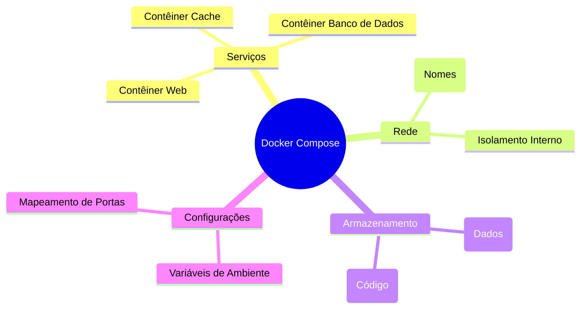
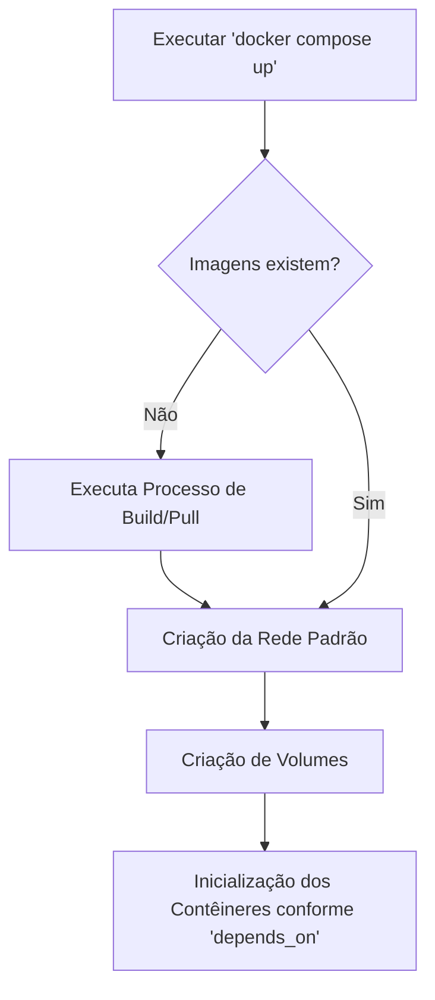

# Docker Compose

O Docker Compose é uma ferramenta projetada para definir e orquestrar aplicações baseadas em múltiplos contêineres. Ele centraliza as configurações estruturais em um único arquivo de manifesto, erradicando a necessidade de gerenciar múltiplos scripts longos de linha de comando para subir serviços interconectados.

---

## 1. Introdução

Enquanto o `Dockerfile` atua como a receita para gerar uma única imagem, o Docker Compose gerencia a infraestrutura da aplicação como um todo, mapeando como bancos de dados, APIs e front-ends se relacionam, expondo portas, declarando redes internas e persistindo dados através de volumes.



## 2. Pré-requisitos e Contexto

* **Docker Compose Instalado:** A ferramenta é nativamente incluída no Docker Desktop. Em sistemas Linux, deve ser validada a presença do plugin através do comando `docker compose version`.


* **Conhecimento em YAML:** O arquivo de configuração baseia-se na sintaxe YAML, onde o aninhamento estrito através de recuos (indentação com exatos dois espaços por nível) é mandatório e tabulações são proibidas.


* **Variáveis de Ambiente:** É recomendada a padronização e externalização de dados sensíveis, exigindo familiaridade com a manipulação de arquivos `.env`.


## 3. Estruturação e Setup

A fundação do Docker Compose dá-se através do arquivo `compose.yaml` (ou `docker-compose.yml`), posicionado na raiz do projeto. A estrutura exige, no mínimo, a declaração do bloco `services:`.

*Arquivo base de configuração:*

```yaml
services:
  <NOME_DO_SERVICO_WEB>:
    build: .
    ports:
      - "<PORTA_LOCAL>:<PORTA_CONTAINER>"
    environment:
      - VARIAVEL_AMBIENTE=${VALOR_VARIAVEL}
    volumes:
      - <NOME_VOLUME>:/caminho/no/container

volumes:
  <NOME_VOLUME>:

```

## 4. Aplicação Prática

A operação no dia a dia consiste na manipulação da stack através da CLI do Compose na mesma pasta do arquivo de configuração.

* **Subir todos os serviços em segundo plano:** `docker compose up -d`

* **Visualizar o status dos serviços:** `docker compose ps`

* **Analisar logs em tempo real:** `docker compose logs -f`

* **Parar e destruir infraestrutura (preservando volumes):** `docker compose down`

* **Reconstruir imagens após alteração de código:** `docker compose up -d --build`




## 5. Casos de Uso e Exemplos

**Exemplo 1: Ambiente de Banco de Dados com Interface Administrativa (PostgreSQL + Adminer)**
Este exemplo ilustra a interconectividade e o condicionamento de dependências via healthcheck.

*Arquivo `compose.yaml`:*

```yaml
services:
  db:
    image: postgres:16
    environment:
      POSTGRES_USER: ${POSTGRES_USER}
      POSTGRES_PASSWORD: ${POSTGRES_PASSWORD}
      POSTGRES_DB: ${POSTGRES_DB}
    volumes:
      - dados_db:/var/lib/postgresql/data
    healthcheck:
      test: ["CMD-SHELL", "pg_isready -U ${POSTGRES_USER} -d ${POSTGRES_DB}"]
      interval: 5s
      timeout: 5s
      retries: 5
    restart: unless-stopped

  adminer:
    image: adminer
    ports:
      - "8080:8080"
    depends_on:
      db:
        condition: service_healthy
    restart: unless-stopped

volumes:
  dados_db:

```

O serviço `adminer` aguardará o teste nativo `pg_isready` garantir que o banco `db` está efetivamente pronto e apto para conexões (service_healthy) antes de iniciar. As variáveis de ambiente devem estar declaradas em um arquivo `.env` na mesma pasta.

## 6. Desafios Comuns e Soluções

* **`port is already allocated`**
* **Causa:** A porta definida no lado host (local) já está sendo ocupada por outro processo no sistema operacional.


* **Solução:** Altere a porta mapeada localizada à esquerda no diretório `ports` do serviço (ex: mude `"8000:5000"` para `"8080:5000"`).


* **Erro de validação do arquivo (ex: `mapping values are not allowed`)**
* **Causa:** Má estruturação, recuo incorreto de níveis ou uso de teclas *Tab* (tabulação) ao longo do arquivo YAML.


* **Solução:** Substitua eventuais tabulações por pares de espaço. Utilize o comando `docker compose config` para validar a sintaxe e identificar a linha comprometida.


* **Perda de dados de banco após reinicialização (`down -v`)**
* **Causa:** Ocultação ou destruição de volumes configurados ao rodar o comando com a flag `-v`, que força a remoção de armazenamento permanente.


* **Solução:** Abstenha-se da flag `-v` a menos que seja intencional zerar dados. Garanta que bancos de dados utilizem declarações persistentes na raiz de `volumes`.


## 7. Referências

* Documentação do Docker Compose: [https://docs.docker.com/compose/](https://docs.docker.com/compose/)

* Referência oficial de sintaxe (Compose-file): [https://docs.docker.com/reference/compose-file/](https://docs.docker.com/reference/compose-file/)