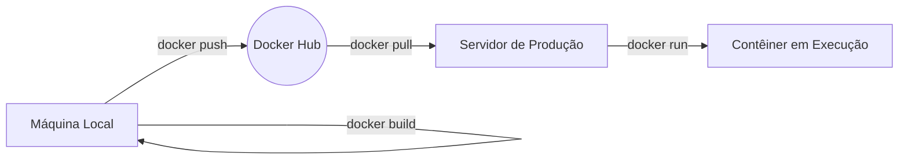
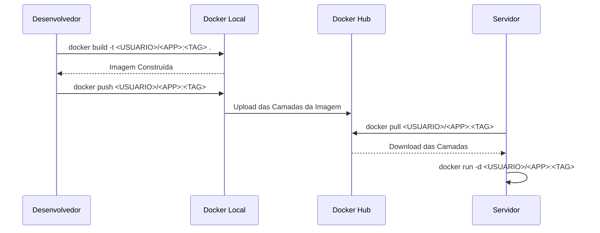

# Docker Hub

O Docker Hub é o registry oficial do ecossistema Docker, operando como um serviço centralizado na internet para o armazenamento, versionamento e distribuição de imagens de contêineres. Ele viabiliza o compartilhamento de imagens com equipes e atua como a fonte principal da qual servidores realizam o download de aplicações para execução em ambientes de produção.

---

## 1. Introdução

O Docker Hub armazena imagens empacotadas com todos os componentes necessários para a execução de uma aplicação, funcionando de maneira análoga ao GitHub, porém voltado para imagens de contêineres em vez de código-fonte. Cada imagem reside em um "Repositório", podendo ser pública ou privada, e o controle de versão é gerenciado por meio de "Tags" (ex: `1.0.0`, `latest`) ou códigos únicos chamados "Digests".



## 2. Pré-requisitos e Contexto

* **Motor Docker:** Necessário ter o Docker Engine instalado localmente.


* **Conta Ativa:** Cadastro realizado na plataforma Docker Hub.


* **Nome de Usuário:** Definição de namespace exclusivo, aceitando apenas letras minúsculas e números.


* **Token de Acesso (PAT):** Criação de um Personal Access Token para autenticação via terminal, garantindo maior segurança que o uso de senha direta.


* **Código-fonte da Aplicação:** Arquivos do projeto acompanhados de um `Dockerfile` configurado.


## 3. Estruturação e Setup

Para habilitar a comunicação da sua máquina local ou servidor com o Docker Hub, configure a autenticação por meio do token de acesso pessoal gerado previamente.

1. Acesse o Docker Hub, navegue até a seção de segurança da conta e gere um "Personal Access Token".


2. No ambiente local, autentique-se utilizando o token:

```bash
docker login -u <SEU_USUARIO>

```

Cole o token quando a senha for solicitada. A mensagem `Login Succeeded` validará o acesso.

## 4. Aplicação Prática

O ciclo de vida padrão de publicação e consumo de uma imagem abrange a construção local, o envio ao registry e o posterior download no ambiente de destino.



**Fluxo de Publicação e Execução:**

1. **Construção da Imagem:**
```bash
docker build -t <SEU_USUARIO>/<NOME_DA_APP>:<TAG> .

```


2. **Envio para o Registry:**
```bash
docker push <SEU_USUARIO>/<NOME_DA_APP>:<TAG>

```


3. **Download e Execução (no Servidor):**
```bash
docker pull <SEU_USUARIO>/<NOME_DA_APP>:<TAG>
docker run -d --name <NOME_DO_CONTAINER> -p <PORTA_SERVIDOR>:<PORTA_APP> --restart unless-stopped <SEU_USUARIO>/<NOME_DA_APP>:<TAG>

```


## 5. Casos de Uso e Exemplos

**Exemplo 1: Automação de Deploy via GitHub Actions**
Uma prática comum é integrar o repositório Git com o Docker Hub para envios automáticos a cada nova versão gerada.

*Arquivo `.github/workflows/publicar.yml*`:

```yaml
name: Publicar imagem no Docker Hub
on:
  push:
    tags:
      - 'v*'
jobs:
  publicar:
    runs-on: ubuntu-latest
    steps:
      - name: Baixar o codigo
        uses: actions/checkout@v4
      - name: Login no Docker Hub
        uses: docker/login-action@v3
        with:
          username: ${{ secrets.DOCKERHUB_USERNAME }}
          password: ${{ secrets.DOCKERHUB_TOKEN }}
      - name: Construir e enviar
        uses: docker/build-push-action@v6
        with:
          context: .
          push: true
          tags: ${{ secrets.DOCKERHUB_USERNAME }}/<NOME_DA_APP>:${{ github.ref_name }}

```

Este pipeline requer a configuração de `DOCKERHUB_USERNAME` e `DOCKERHUB_TOKEN` nos Secrets do repositório.

**Exemplo 2: Otimização de Build Multi-Arquitetura**
Para garantir compatibilidade entre servidores (amd64) e máquinas locais (arm64, como processadores Apple Silicon), deve-se construir imagens multiplataforma.

```bash
docker buildx build --platform linux/amd64,linux/arm64 -t <SEU_USUARIO>/<NOME_DA_APP>:<TAG> --push .

```

## 6. Desafios Comuns e Soluções

* **`denied: requested access to the resource is denied`**
* **Causa:** Autenticação pendente ou nomenclatura incorreta.


* **Solução:** Execute `docker login` e certifique-se de que o nome da imagem inicia com seu nome de usuário (ex: `<SEU_USUARIO>/<NOME_DA_APP>`).


* **`unauthorized: incorrect username or password`**
* **Causa:** Credenciais inválidas fornecidas no login.


* **Solução:** Revogue o token atual, gere um novo token de acesso (PAT) na plataforma Docker Hub e refaça o processo de login no terminal.


* **`exec format error` ao iniciar o contêiner no servidor**
* **Causa:** Incompatibilidade de arquitetura da CPU (imagem construída em ARM, servidor em AMD64, ou vice-versa).


* **Solução:** Construa a imagem especificando a arquitetura do servidor alvo utilizando a flag `--platform linux/amd64`.


## 7. Referências

* Docker Hub Oficial: [https://hub.docker.com](https://hub.docker.com)

* Documentação do Docker Hub: [https://docs.docker.com/docker-hub/](https://docs.docker.com/docker-hub/)


