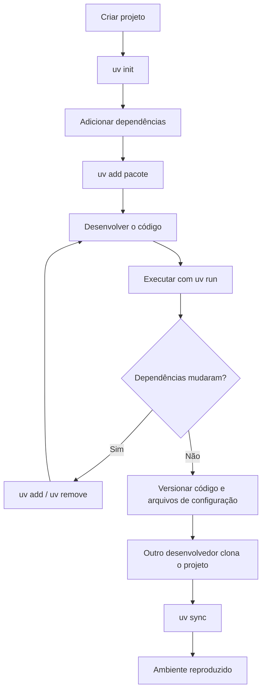

# Ambientes Virtuais Python e uv

## 1. Introdução

O Python é uma linguagem de programação amplamente utilizada no desenvolvimento de aplicações, automação de tarefas, análise de dados e inteligência artificial. Durante o desenvolvimento de projetos, é comum utilizar bibliotecas externas que oferecem funcionalidades adicionais, evitando a necessidade de implementar tudo do zero.

Entretanto, à medida que diferentes projetos são desenvolvidos, surge um problema: cada projeto pode depender de bibliotecas diferentes ou até mesmo de versões distintas de uma mesma biblioteca. Sem um mecanismo de isolamento, essas dependências podem entrar em conflito, comprometendo o funcionamento das aplicações.

Para resolver esse problema, o Python utiliza ambientes virtuais (*virtual environments*), que permitem separar as dependências de cada projeto.

A Pi Júnior adota o **uv** como ferramenta padrão para gerenciamento de projetos, ambientes virtuais e dependências Python. O objetivo deste guia é apresentar os conceitos necessários para compreender esse funcionamento e ensinar a utilizar o uv no desenvolvimento de projetos da empresa.

## 2. Fundamentos dos Ambientes Virtuais Python

### 2.1. O que são dependências?

Uma dependência é uma biblioteca ou pacote externo que um projeto utiliza para executar determinada funcionalidade.

Por exemplo, considere um projeto Python que precisa realizar operações com tabelas e dados. Em vez de implementar todas essas operações manualmente, o desenvolvedor pode utilizar a biblioteca `pandas`, que oferece ferramentas para manipulação e análise de dados.

Outros exemplos de bibliotecas bastante utilizadas são:

- `numpy`: operações matemáticas e computação numérica.
- `requests`: realização de requisições HTTP.
- `matplotlib`: criação de gráficos e visualizações.
- `flask`: desenvolvimento de aplicações web.

Essas bibliotecas precisam ser instaladas no ambiente Python para que possam ser utilizadas no código por meio do comando `import`.

### 2.2. O problema do compartilhamento de dependências

Imagine que um desenvolvedor esteja trabalhando simultaneamente em dois projetos:

- **Projeto A:** utiliza a versão 1.x de determinada biblioteca.
- **Projeto B:** precisa da versão 2.x da mesma biblioteca.

Se as duas versões forem instaladas diretamente no ambiente global do Python, uma instalação poderá substituir a outra. Isso pode fazer com que um dos projetos deixe de funcionar corretamente.

Esse problema acontece porque, sem isolamento, diferentes projetos podem compartilhar o mesmo conjunto de bibliotecas instaladas.

Além disso, instalar todas as dependências globalmente pode gerar outros problemas:

- Conflitos entre versões de bibliotecas.
- Dificuldade para reproduzir o ambiente de desenvolvimento em outra máquina.
- Acúmulo de pacotes que não são utilizados por todos os projetos.
- Alterações em dependências que podem afetar aplicações que já estavam funcionando.

### 2.3. O que são ambientes virtuais?

Um ambiente virtual é uma estrutura isolada que mantém suas próprias bibliotecas, pacotes e executáveis Python, separando as dependências de um projeto das dependências de outros projetos e da instalação global do Python.

Na prática, cada projeto pode possuir seu próprio ambiente virtual, permitindo utilizar versões específicas de bibliotecas sem interferir nos demais.

Por exemplo:

- Projeto A possui um ambiente virtual com `pandas` na versão 1.x.
- Projeto B possui outro ambiente virtual com `pandas` na versão 2.x.

Mesmo utilizando a mesma máquina, os dois projetos conseguem manter suas dependências separadas.

**Representação da estrutura:**

```text
computador/
│
├── projeto-a/
│   ├── .venv/
│   │   └── bibliotecas do projeto A
│   └── main.py
│
└── projeto-b/
    ├── .venv/
    │   └── bibliotecas do projeto B
    └── main.py
```

Cada diretório `.venv` representa um ambiente virtual independente.

### 2.4. Como funciona a pasta `.venv`?

Por convenção, ambientes virtuais Python são frequentemente armazenados em diretórios chamados `.venv`, localizados na raiz do projeto.

Esse diretório contém os arquivos necessários para executar o Python naquele ambiente e armazenar suas dependências.

Sua estrutura interna varia conforme o sistema operacional. Em sistemas Linux e macOS, é comum encontrar:

```text
.venv/
├── bin/
│   ├── python
│   ├── pip
│   └── activate
├── lib/
│   └── pythonX.Y/
│       └── site-packages/
└── pyvenv.cfg
```

No Windows, os executáveis e scripts ficam normalmente em `Scripts/`, em vez de `bin/`.

Os principais componentes são:

- **bin/ ou Scripts/:** contém os executáveis e scripts utilizados pelo ambiente, incluindo o interpretador Python e o script de ativação.
- **lib/:** armazena as bibliotecas instaladas no ambiente, geralmente dentro de `site-packages/`.
- **pyvenv.cfg:** arquivo de configuração que registra informações sobre o ambiente virtual e a instalação base do Python utilizada para criá-lo.

O interpretador presente no ambiente virtual está associado a uma instalação base do Python. Dependendo do sistema operacional, ele pode ser copiado ou vinculado à instalação original. As bibliotecas instaladas, entretanto, ficam isoladas no ambiente.

**Importante:** o diretório `.venv` não deve ser enviado ao Git. Ele contém arquivos específicos da máquina e pode ser recriado a partir das informações de dependências do projeto.

### 2.5. Isolamento e versões do Python

Além das versões das bibliotecas, projetos diferentes também podem exigir versões distintas do próprio Python.

Por exemplo:

- Projeto A utiliza Python 3.10.
- Projeto B utiliza Python 3.12.

Os ambientes virtuais permitem associar cada projeto a uma instalação específica do interpretador Python, mantendo suas dependências separadas.

É importante compreender que o ambiente virtual não instala necessariamente uma versão completamente independente do Python: ele utiliza um interpretador base disponível no sistema ou instalado por uma ferramenta de gerenciamento.

No caso do uv, é possível instalar e selecionar versões do Python para cada projeto, facilitando esse gerenciamento.

Essa separação permite que diferentes projetos sejam desenvolvidos na mesma máquina sem exigir que todos utilizem as mesmas versões de Python e de suas bibliotecas.

## 3. Instalação e Importação de Bibliotecas

### 3.1. O que é o PyPI?

O **Python Package Index (PyPI)** é o repositório público oficial de pacotes Python. Ele permite que desenvolvedores publiquem e compartilhem bibliotecas para que outras pessoas possam utilizá-las em seus projetos.

Quando um desenvolvedor precisa utilizar uma biblioteca externa, normalmente pode buscá-la no PyPI e instalá-la por meio de um gerenciador de pacotes.

O endereço oficial é: https://pypi.org/

Cada projeto publicado no PyPI possui uma página com informações como:

- Nome do pacote.
- Versões disponíveis.
- Descrição e funcionalidades.
- Instruções de instalação.
- Dependências necessárias.
- Informações sobre os desenvolvedores.

Por exemplo, ao pesquisar por `requests`, encontramos uma biblioteca que facilita a realização de requisições HTTP em Python.

### 3.2. Como funciona a instalação de uma biblioteca?

Tradicionalmente, o Python utiliza o `pip` como gerenciador de pacotes. Ele permite buscar, baixar e instalar bibliotecas disponíveis no PyPI.

Por exemplo, para instalar a biblioteca `requests`, podemos executar:

```bash
python -m pip install requests
```

O processo acontece da seguinte maneira:

1. O gerenciador de pacotes recebe o nome da biblioteca solicitada.
2. Consulta o índice de pacotes configurado, normalmente o PyPI.
3. Identifica uma versão compatível com os requisitos informados.
4. Baixa o pacote e suas dependências necessárias.
5. Instala os arquivos no ambiente Python selecionado.

É importante observar que uma biblioteca pode depender de outras bibliotecas para funcionar. Essas dependências também precisam ser instaladas, formando uma árvore de dependências.

Por exemplo:

```text
meu-projeto
│
└── requests
    ├── certifi
    ├── charset-normalizer
    ├── idna
    └── urllib3
```

Nesse exemplo, ao instalar `requests`, o gerenciador também instala os pacotes necessários para seu funcionamento.

**Atenção:** a instalação deve ocorrer no ambiente virtual correspondente ao projeto. Dessa forma, as bibliotecas não são adicionadas indiscriminadamente à instalação global do Python.

### 3.3. Diferença entre instalar e importar uma biblioteca

Instalar e importar são operações diferentes, embora estejam relacionadas.

- **Instalar:** disponibiliza os arquivos da biblioteca no ambiente Python.
- **Importar:** permite utilizar as funcionalidades dessa biblioteca dentro de um programa.

Depois de instalar `requests`, por exemplo, podemos utilizá-la no código:

```python
import requests

resposta = requests.get("https://example.com")

print(resposta.status_code)
```

O comando `import requests` não instala a biblioteca. Ele apenas solicita ao interpretador Python que carregue o módulo para utilização no programa.

Se a biblioteca não estiver instalada no ambiente utilizado, o Python poderá apresentar um erro como:

```text
ModuleNotFoundError: No module named 'requests'
```

Esse erro indica que o interpretador não encontrou o módulo solicitado nos caminhos de importação disponíveis.

### 3.4. Nome do pacote e nome de importação

Nem sempre o nome utilizado para instalar uma biblioteca é igual ao nome utilizado no código Python.

Por exemplo:

| Pacote instalado | Importação no código |
|---|---|
| `requests` | `import requests` |
| `beautifulsoup4` | `from bs4 import BeautifulSoup` |
| `Pillow` | `from PIL import Image` |

Isso acontece porque o nome de distribuição do pacote e o nome do módulo ou pacote de importação são conceitos diferentes.

Por isso, ao utilizar uma biblioteca pela primeira vez, é importante consultar sua documentação para verificar a forma correta de importação.

### 3.5. Gerenciamento de dependências e versões

Além de instalar bibliotecas, é necessário controlar quais dependências cada projeto utiliza e quais versões são compatíveis.

Considere um projeto que utiliza:

- `requests` na versão 2.x.
- `pandas` na versão 2.x.
- `numpy` na versão 1.x.

Essas informações precisam ser registradas para que outros desenvolvedores consigam reproduzir o ambiente.

Sem esse controle, uma instalação futura pode selecionar versões diferentes das utilizadas originalmente, causando incompatibilidades ou alterações no comportamento da aplicação.

É nesse contexto que ferramentas como o `uv` são importantes: elas permitem declarar, resolver, registrar e sincronizar as dependências de um projeto.

## 4. Organização de Projetos Python

### 4.1. Estrutura recomendada de diretórios

Um projeto Python deve possuir uma estrutura organizada, separando o código-fonte, os testes, a documentação e os arquivos de configuração.

Uma estrutura possível para projetos da Pi Júnior é:

```text
meu-projeto/
│
├── .venv/
│
├── src/
│   └── meu_projeto/
│       ├── __init__.py
│       └── main.py
│
├── tests/
│   └── test_main.py
│
├── .gitignore
├── .python-version
├── pyproject.toml
├── uv.lock
└── README.md
```

Os principais elementos são:

- **src/:** diretório que concentra o código-fonte do projeto.
- **meu_projeto/:** pacote Python que contém os módulos da aplicação.
- **tests/:** diretório destinado aos testes automatizados.
- **.venv/:** ambiente virtual utilizado pelo projeto.
- **.gitignore:** arquivo que define quais arquivos e diretórios não devem ser acompanhados pelo Git.
- **.python-version:** registra a versão padrão do Python utilizada pelo projeto.
- **pyproject.toml:** contém os metadados, configurações e declarações de dependências do projeto.
- **uv.lock:** registra as versões exatas das dependências resolvidas.
- **README.md:** apresenta informações sobre o projeto, sua finalidade e instruções de utilização.

Essa é uma estrutura de referência. Projetos menores ou scripts simples podem utilizar organizações mais enxutas.

### 4.2. Por que não devemos versionar a pasta `.venv`?

O Git deve armazenar os arquivos necessários para compartilhar e manter o projeto, mas não precisa armazenar todas as bibliotecas instaladas na máquina de cada desenvolvedor.

A pasta `.venv` não deve ser adicionada ao repositório porque:

- Pode ocupar bastante espaço devido à quantidade de bibliotecas instaladas.
- Contém executáveis e caminhos específicos do sistema operacional.
- Pode estar associada a uma instalação específica do Python na máquina.
- Pode ser recriada a partir das informações de dependências do projeto.

Em vez de compartilhar a pasta `.venv`, compartilhamos os arquivos de configuração e controle de dependências.

No fluxo com uv, os principais arquivos são `pyproject.toml` e `uv.lock`. Com eles, outro desenvolvedor pode recriar o ambiente utilizando `uv sync`.

### 4.3. Configurando o `.gitignore`

Para impedir que a pasta `.venv` seja enviada ao Git, devemos incluí-la no arquivo `.gitignore`, localizado na raiz do projeto.

Exemplo:

```gitignore
# Ambientes virtuais Python
.venv/

# Arquivos de cache do Python
__pycache__/
*.py[cod]

# Arquivos de configuração de editores
.vscode/
.idea/

# Arquivos de ambiente e possíveis segredos
.env
```

O `.gitignore` informa ao Git quais arquivos e diretórios devem ser ignorados quando ainda não estão sendo acompanhados pelo controle de versão.

**Importante:** o `.gitignore` não remove automaticamente arquivos que já foram adicionados ao Git anteriormente. Caso a `.venv` já esteja sendo versionada, será necessário removê-la do índice do Git.

### 4.4. O que deve ser enviado ao GitHub?

Em um projeto Python gerenciado pelo uv, devemos versionar os arquivos necessários para que os demais desenvolvedores compreendam e reproduzam o ambiente.

| Arquivo ou diretório | Versionar? | Motivo |
|---|---|---|
| `src/` | Sim | Contém o código-fonte. |
| `tests/` | Sim | Contém os testes do projeto. |
| `README.md` | Sim | Documentação inicial. |
| `pyproject.toml` | Sim | Declara dependências e configurações. |
| `uv.lock` | Sim | Registra as versões resolvidas. |
| `.python-version` | Sim | Indica a versão padrão do Python. |
| `.gitignore` | Sim | Define arquivos ignorados pelo Git. |
| `.venv/` | Não | Ambiente virtual recriável e específico da máquina. |
| `__pycache__/` | Não | Arquivos de cache gerados pelo Python. |
| `.env` | Não | Pode conter variáveis e informações sensíveis. |

Atenção: arquivos `.env` não devem ser compartilhados quando contêm senhas, tokens ou outras credenciais. Caso o projeto precise de variáveis de ambiente, podemos disponibilizar um arquivo de exemplo, como `.env.example`, sem valores secretos.

### 4.5. Reproduzindo o ambiente em outra máquina

Imagine que uma pessoa da equipe acabou de clonar um repositório Python que utiliza uv.

Ela não precisa receber a pasta `.venv` de quem desenvolveu o projeto. Basta ter o uv instalado e executar, na raiz do repositório:

```bash
uv sync
```

O uv utiliza as informações declaradas no projeto e no arquivo de lock para instalar as dependências e preparar o ambiente virtual.

Dessa forma, todos os integrantes da equipe podem trabalhar com as mesmas versões resolvidas de dependências, reduzindo problemas de incompatibilidade entre máquinas.

Esse processo torna o desenvolvimento colaborativo mais previsível e facilita a manutenção dos projetos.

## 5. Conhecendo o uv

### 5.1. O que é o uv?

O **uv** é uma ferramenta de gerenciamento de projetos e pacotes Python, desenvolvida pela Astral e escrita em Rust. Seu objetivo é reunir em uma única ferramenta diversas operações que tradicionalmente exigiriam programas diferentes.

Com o uv, podemos:

- Instalar e gerenciar versões do Python.
- Criar e gerenciar ambientes virtuais.
- Instalar, adicionar e remover bibliotecas.
- Resolver conflitos entre dependências.
- Registrar versões de pacotes em arquivos de lock.
- Executar scripts e comandos dentro do ambiente do projeto.

Uma das principais vantagens do uv é centralizar essas operações em uma interface simples, utilizando comandos como `uv init`, `uv add`, `uv remove`, `uv sync` e `uv run`.

### 5.2. Como o uv se relaciona com outras ferramentas?

Antes do uv, era comum utilizar diferentes ferramentas para realizar tarefas relacionadas ao gerenciamento de projetos Python:

| Ferramenta | Finalidade tradicional |
|---|---|
| `pip` | Instalar pacotes Python. |
| `venv` | Criar ambientes virtuais. |
| `pyenv` | Gerenciar versões do Python. |
| `pip-tools` | Gerenciar e fixar versões de dependências. |
| `uv` | Reunir diversas dessas funcionalidades em uma única ferramenta. |

O uv não exige que o desenvolvedor abandone imediatamente todas as ferramentas anteriores. Ele também oferece uma interface compatível com operações comuns do pip, mas este guia utilizará principalmente o gerenciamento de projetos próprio do uv.

## 6. Instalação do uv

### 6.1. Requisitos

O uv pode ser instalado em sistemas Linux, macOS e Windows.

Uma característica importante é que o uv pode ser instalado sem que o Python esteja previamente instalado, pois os instaladores oficiais disponibilizam executáveis prontos para diferentes sistemas.

Para utilizar os comandos de instalação apresentados a seguir, é necessário ter acesso à internet e a um terminal.

### 6.2. Instalação no Linux e macOS

A instalação oficial pode ser realizada pelo terminal utilizando `curl`:

```bash
curl -LsSf https://astral.sh/uv/install.sh | sh
```

Esse comando executa as seguintes operações:

1. `curl`: realiza uma requisição para baixar o instalador.
2. `-L`: permite acompanhar redirecionamentos.
3. `-s`: executa de forma silenciosa.
4. `-S`: apresenta mensagens de erro caso ocorram problemas.
5. `-f`: faz a requisição falhar diante de erros HTTP.
6. `| sh`: encaminha o conteúdo baixado para o interpretador de comandos `sh`, que executa o instalador.

Caso o sistema não possua `curl`, também é possível utilizar `wget`:

```bash
wget -qO- https://astral.sh/uv/install.sh | sh
```

Após a instalação, pode ser necessário abrir um novo terminal ou atualizar a sessão do shell para que o executável seja reconhecido pelo sistema.

### 6.3. Instalação no Windows

No Windows, a instalação oficial pode ser realizada pelo PowerShell:

```powershell
powershell -ExecutionPolicy ByPass -c "irm https://astral.sh/uv/install.ps1 | iex"
```

Nesse comando:

- `irm` é um alias de `Invoke-RestMethod`, utilizado para obter o conteúdo do instalador.
- `iex` é um alias de `Invoke-Expression`, utilizado para executar o conteúdo recebido.
- `-ExecutionPolicy ByPass` permite executar o script sem aplicar as restrições usuais da política de execução naquela chamada.

É importante executar o comando em um terminal PowerShell, e não no Prompt de Comando tradicional (CMD).

### 6.4. Verificando a instalação

Independentemente do sistema operacional, podemos verificar se o uv foi instalado corretamente executando:

```bash
uv --version
```

O terminal deverá apresentar a versão instalada, por exemplo:

```text
uv 0.x.x
```

O número exibido varia conforme a versão disponível no momento da instalação.

Caso o terminal informe que o comando `uv` não foi encontrado, verifique se o diretório de instalação foi adicionado à variável de ambiente `PATH` e abra uma nova sessão do terminal.

## 7. Criando e Gerenciando um Projeto com uv

Nesta seção, será apresentado um fluxo de trabalho completo utilizando o uv. O exemplo consiste na criação de um projeto Python, instalação de bibliotecas, execução de código e sincronização do ambiente.

### 7.1. Criando um projeto com `uv init`

O comando `uv init` inicializa um novo projeto Python.

Para criar um projeto chamado `meu-projeto`, execute:

```bash
uv init meu-projeto
```

Em seguida, entre no diretório:

```bash
cd meu-projeto
```

O uv cria os arquivos iniciais necessários para a organização do projeto. A estrutura gerada pode variar conforme o tipo de projeto e as opções utilizadas, mas pode incluir:

```text
meu-projeto/
├── .git/
├── .gitignore
├── .python-version
├── pyproject.toml
├── README.md
└── src/
    └── meu_projeto/
        └── __init__.py
```

O comando `uv init` prepara a estrutura inicial, mas não necessariamente cria imediatamente o ambiente virtual e o arquivo `uv.lock`. Esses elementos são gerados quando uma operação do projeto precisa deles, como `uv sync` ou `uv run`.

### 7.2. Adicionando dependências com `uv add`

Para adicionar uma biblioteca ao projeto, utilizamos:

```bash
uv add requests
```

Esse comando realiza três operações principais:

1. Registra `requests` como dependência do projeto no arquivo `pyproject.toml`.
2. Atualiza o arquivo `uv.lock` com as versões resolvidas das dependências.
3. Sincroniza o ambiente virtual, instalando os pacotes necessários.

Também é possível especificar uma versão ou restrição de versão:

```bash
uv add "requests>=2.31,<3"
```

Nesse exemplo, o projeto aceita versões a partir de 2.31, mas inferiores à versão 3.

É importante utilizar aspas quando a restrição contém caracteres que podem ser interpretados pelo shell.

Para adicionar mais de uma biblioteca, basta informar os pacotes no mesmo comando:

```bash
uv add requests pandas numpy
```

### 7.3. Removendo dependências com `uv remove`

Caso uma biblioteca deixe de ser necessária, podemos removê-la utilizando:

```bash
uv remove requests
```

O comando remove a dependência da declaração do projeto, atualiza o arquivo `uv.lock` e sincroniza o ambiente virtual.

Dessa forma, a biblioteca deixa de fazer parte das dependências declaradas pelo projeto.

### 7.4. Sincronizando o ambiente com `uv sync`

O comando `uv sync` garante que o ambiente virtual esteja de acordo com as dependências registradas no projeto e no arquivo de lock.

```bash
uv sync
```

Caso a pasta `.venv` ainda não exista, o uv irá criá-la automaticamente.

Em seguida, instalará as dependências necessárias para o projeto.

Por padrão, a sincronização é exata: pacotes que não fazem parte do conjunto de dependências selecionado podem ser removidos do ambiente.

Esse comando é especialmente útil quando:

- Um desenvolvedor acabou de clonar um repositório.
- As dependências foram modificadas.
- O ambiente virtual foi excluído.
- É necessário reconstruir o ambiente a partir dos arquivos do projeto.

Por exemplo, depois de clonar um repositório que contém `pyproject.toml` e `uv.lock`, basta executar `uv sync` na raiz do projeto para preparar o ambiente.

### 7.5. Executando comandos com `uv run`

O comando `uv run` permite executar scripts e outros comandos dentro do ambiente do projeto.

Para executar um arquivo Python:

```bash
uv run main.py
```

Também podemos executar comandos diretamente:

```bash
uv run python --version
```

Uma vantagem importante é que não precisamos ativar manualmente o ambiente virtual antes de executar o código.

Antes da execução, o uv verifica se o arquivo de lock está atualizado em relação às dependências declaradas e se o ambiente está sincronizado. Quando necessário, realiza as atualizações antes de executar o comando.

Assim, `uv run` reduz a possibilidade de executar um programa utilizando um ambiente desatualizado ou diferente daquele definido pelo projeto.

### 7.6. Resumo dos principais comandos

| Comando | Finalidade |
|---|---|
| `uv init` | Inicializa um novo projeto Python. |
| `uv add pacote` | Adiciona uma dependência ao projeto. |
| `uv remove pacote` | Remove uma dependência do projeto. |
| `uv sync` | Sincroniza o ambiente com as dependências declaradas e o lockfile. |
| `uv run comando` | Executa um comando no ambiente do projeto. |
| `uv lock` | Atualiza ou cria o arquivo de lock. |
| `uv tree` | Exibe a árvore de dependências do projeto. |

### 7.7. Fluxo de trabalho recomendado

O fluxo abaixo representa uma sequência comum de utilização do uv durante o desenvolvimento de um projeto:



O objetivo desse fluxo é garantir que o projeto tenha suas dependências declaradas e que o ambiente possa ser reconstruído em outras máquinas sem a necessidade de compartilhar a pasta `.venv`.