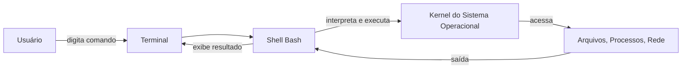
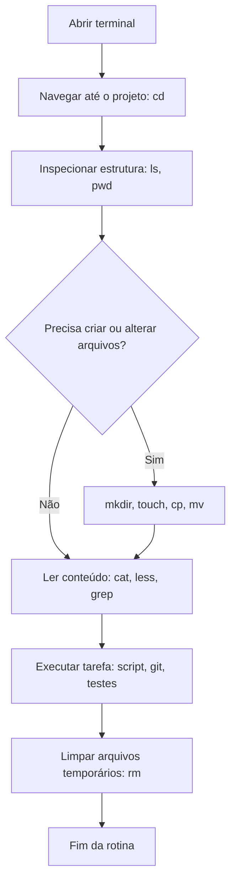

# Guia Introdutório do Terminal Bash

Este documento apresenta o terminal Bash como ferramenta de trabalho para o desenvolvimento de software na Pi Júnior. Aborda os conceitos de interface de linha de comando (CLI), os comandos essenciais de navegação, manipulação de arquivos e permissões, além da criação de scripts `.sh` para automação de tarefas repetitivas.

O objetivo é reduzir a barreira de entrada de trainees e novos membros, que frequentemente precisam operar servidores remotos, repositórios Git e ambientes de desenvolvimento sem interface gráfica. Ao final, o leitor será capaz de navegar pelo sistema de arquivos, manipular arquivos e diretórios, inspecionar conteúdos e escrever scripts simples de uso geral.

---

## 1. Introdução

O **terminal** é a janela em que o usuário digita comandos. O **shell** é o programa que interpreta esses comandos e os repassa ao sistema operacional. O **Bash** (Bourne Again Shell) é o shell mais difundido em sistemas Linux e está disponível também em macOS e no Windows (via WSL ou Git Bash).

### CLI versus GUI

| Critério | CLI (linha de comando) | GUI (interface gráfica) |
|---|---|---|
| Interação | Comandos digitados | Cliques e menus |
| Automação | Alta: comandos podem ser encadeados e salvos em scripts | Baixa: depende de ações manuais |
| Velocidade | Alta para tarefas repetitivas | Maior para tarefas exploratórias |
| Consumo de recursos | Mínimo | Elevado |
| Acesso remoto | Nativo (SSH) | Limitado ou inexistente |
| Curva de aprendizado | Mais íngreme | Mais suave |

Na prática, a CLI é indispensável no desenvolvimento por três motivos: **automação** (tarefas repetitivas viram scripts), **velocidade** (operações em lote em segundos) e **acesso a servidores remotos**, que geralmente não possuem ambiente gráfico.



## 2. Pré-requisitos e Contexto

- Acesso a um terminal Bash:
    - **Linux:** disponível por padrão (atalho comum: `Ctrl + Alt + T`).
    - **macOS:** aplicativo Terminal (o shell padrão atual é o Zsh, mas o Bash está disponível com sintaxe compatível).
    - **Windows:** WSL2 (recomendado) ou Git Bash.
- Editor de texto para escrever scripts (VS Code, Vim ou Nano).
- Noções básicas de estrutura de diretórios (pastas e arquivos).
- Convenção de leitura deste guia: o símbolo `$` indica o prompt do terminal e **não** deve ser digitado. Termos entre `<>` são variáveis a serem substituídas.

Verifique a versão instalada:

```bash
$ bash --version
```

## 3. Estruturação e Setup

### 3.1 Anatomia de um comando

```bash
$ comando [opções] [argumentos]
$ ls -l /home/<SEU_USUARIO>
```

- **comando:** programa a ser executado (`ls`).
- **opções (flags):** modificam o comportamento (`-l`).
- **argumentos:** alvo da operação (`/home/<SEU_USUARIO>`).

### 3.2 Comandos fundamentais por categoria

#### Navegação

| Comando | Função | Exemplo |
|---|---|---|
| `pwd` | Exibe o diretório atual | `pwd` |
| `ls` | Lista o conteúdo do diretório | `ls -la` (inclui ocultos, formato detalhado) |
| `cd` | Muda de diretório | `cd <PASTA>`, `cd ..`, `cd ~`, `cd -` |

#### Manipulação de arquivos e diretórios

| Comando | Função | Exemplo |
|---|---|---|
| `mkdir` | Cria diretórios | `mkdir -p src/utils` (cria toda a hierarquia) |
| `touch` | Cria arquivo vazio ou atualiza data de modificação | `touch main.py` |
| `cp` | Copia arquivos ou diretórios | `cp a.txt b.txt`, `cp -r pasta/ copia/` |
| `mv` | Move ou renomeia | `mv antigo.txt novo.txt` |
| `rm` | Remove arquivos ou diretórios | `rm arquivo.txt`, `rm -r pasta/` |

> **Atenção:** o `rm` não envia itens para a lixeira. A remoção é definitiva. Evite `rm -rf` sem conferir o caminho com `pwd` e `ls` antes.

#### Leitura e busca

| Comando | Função | Exemplo |
|---|---|---|
| `cat` | Exibe o conteúdo completo de um arquivo | `cat README.md` |
| `less` | Exibe com paginação (sair com `q`) | `less log.txt` |
| `grep` | Busca padrões de texto | `grep -rn "TODO" src/` |

#### Permissões

O comando `chmod` altera as permissões de leitura (`r`), escrita (`w`) e execução (`x`).

```bash
$ chmod +x script.sh      # torna o arquivo executável
$ chmod 755 script.sh     # dono: rwx | grupo: r-x | outros: r-x
$ ls -l script.sh         # confere as permissões
```

| Valor | Permissão |
|---|---|
| 4 | Leitura (`r`) |
| 2 | Escrita (`w`) |
| 1 | Execução (`x`) |

Os valores são somados por classe (dono, grupo, outros). Exemplo: `755` = `7 (4+2+1)`, `5 (4+1)`, `5 (4+1)`.

### 3.3 Operadores essenciais

| Operador | Função | Exemplo |
|---|---|---|
| `\|` | Encadeia a saída de um comando na entrada de outro | `ls \| grep ".py"` |
| `>` | Redireciona saída para arquivo (sobrescreve) | `echo "oi" > a.txt` |
| `>>` | Redireciona saída para arquivo (acrescenta) | `echo "oi" >> a.txt` |
| `&&` | Executa o próximo comando somente se o anterior tiver sucesso | `mkdir x && cd x` |
| `*` | Curinga (qualquer sequência de caracteres) | `rm *.tmp` |

## 4. Aplicação Prática

### 4.1 Fluxo de trabalho diário



### 4.2 Tutorial: rotina de desenvolvimento simulada

Execute a sequência abaixo em ordem. Ela cria uma estrutura de projeto, navega por ela, inspeciona arquivos e limpa o ambiente.

**Passo 1: criar a estrutura do projeto**

```bash
$ cd ~
$ mkdir -p <NOME_DO_PROJETO>/{src,docs,tests,tmp}
$ cd <NOME_DO_PROJETO>
$ pwd
$ ls
```

A expansão `{src,docs,tests,tmp}` cria os quatro subdiretórios em um único comando.

**Passo 2: criar arquivos**

```bash
$ touch src/main.py src/utils.py tests/test_main.py docs/README.md
$ echo "# <NOME_DO_PROJETO>" > docs/README.md
$ echo "print('Olá, mundo')" > src/main.py
$ echo "# TODO: implementar funções auxiliares" > src/utils.py
```

**Passo 3: navegar entre pastas**

```bash
$ cd src
$ pwd
$ cd ../docs
$ cd -              # volta ao diretório anterior
$ cd ~/<NOME_DO_PROJETO>
```

**Passo 4: inspecionar conteúdos**

```bash
$ ls -la src/
$ cat src/main.py
$ less docs/README.md
$ grep -rn "TODO" .
```

**Passo 5: copiar, renomear e criar arquivos temporários**

```bash
$ cp src/main.py src/main_backup.py
$ mv src/main_backup.py tmp/main_backup.py
$ touch tmp/cache1.tmp tmp/cache2.tmp
```

**Passo 6: limpar temporários**

```bash
$ ls tmp/                 # conferir antes de remover
$ rm tmp/*.tmp
$ ls tmp/
```

**Passo 7: remover o projeto de teste ao final**

```bash
$ cd ~
$ rm -r <NOME_DO_PROJETO>
```

### 4.3 Introdução a scripts `.sh`

Um script Bash é um arquivo de texto com comandos executados em sequência. Estrutura mínima:

```bash
#!/bin/bash
# Descrição: breve explicação do que o script faz

echo "Executando script"
```

Execução:

```bash
$ chmod +x meu_script.sh
$ ./meu_script.sh
```

A primeira linha (`#!/bin/bash`, chamada *shebang*) informa ao sistema qual interpretador usar.

**Elementos básicos da linguagem:**

```bash
#!/bin/bash

# Variáveis (sem espaços ao redor do "=")
nome="Pi Júnior"
echo "Bem-vindo à $nome"

# Argumentos recebidos: $1, $2, ... ; total em $#
echo "Primeiro argumento: $1"

# Condicional
if [ -d "src" ]; then
    echo "Diretório src existe"
else
    echo "Diretório src não existe"
fi

# Laço de repetição
for arquivo in *.txt; do
    echo "Processando $arquivo"
done
```

## 5. Casos de Uso e Exemplos

### 5.1 Script de criação de estrutura de projeto

```bash
#!/bin/bash
# Cria a estrutura padrão de um projeto a partir de um nome informado.
# Uso: ./novo_projeto.sh <NOME_DO_PROJETO>

set -e  # interrompe o script em caso de erro

if [ -z "$1" ]; then
    echo "Uso: $0 <NOME_DO_PROJETO>"
    exit 1
fi

projeto="$1"

mkdir -p "$projeto"/{src,docs,tests}
touch "$projeto/src/main.py"
echo "# $projeto" > "$projeto/docs/README.md"

echo "Projeto '$projeto' criado com sucesso."
```

### 5.2 Script de backup com data

```bash
#!/bin/bash
# Compacta um diretório em um arquivo .tar.gz com a data atual.
# Uso: ./backup.sh <DIRETORIO_ORIGEM> <DIRETORIO_DESTINO>

origem="$1"
destino="$2"
data=$(date +%Y-%m-%d_%H-%M-%S)
arquivo="$destino/backup_$data.tar.gz"

mkdir -p "$destino"
tar -czf "$arquivo" "$origem"

echo "Backup criado em: $arquivo"
```

### 5.3 Script de limpeza de temporários

```bash
#!/bin/bash
# Remove arquivos temporários de um diretório, com confirmação.
# Uso: ./limpar_tmp.sh <DIRETORIO>

alvo="${1:-.}"  # usa o diretório atual se nenhum for informado

echo "Arquivos que serão removidos:"
find "$alvo" -type f \( -name "*.tmp" -o -name "*.log" \)

read -p "Confirmar remoção? (s/n): " resposta
if [ "$resposta" = "s" ]; then
    find "$alvo" -type f \( -name "*.tmp" -o -name "*.log" \) -delete
    echo "Remoção concluída."
else
    echo "Operação cancelada."
fi
```

## 6. Desafios Comuns e Soluções

| Problema | Causa provável | Solução |
|---|---|---|
| `Permission denied` ao executar `./script.sh` | O arquivo não possui permissão de execução | Execute `chmod +x script.sh` |
| `command not found` | Erro de digitação, programa não instalado ou fora do `PATH` | Confira o nome do comando; use `which <COMANDO>` para verificar a instalação |
| `No such file or directory` | Caminho incorreto ou diretório atual diferente do esperado | Use `pwd` e `ls` para confirmar a localização; prefira caminhos absolutos em scripts |
| Arquivos ou pastas com espaços no nome quebram o comando | O Bash interpreta o espaço como separador de argumentos | Use aspas: `cd "Meus Documentos"` e `"$variavel"` em scripts |
| Remoção acidental de arquivos com `rm` | Não há lixeira na linha de comando | Liste com `ls` o alvo antes de remover; use `rm -i` para pedir confirmação |

## 7. Referências

- [GNU Bash Reference Manual](https://www.gnu.org/software/bash/manual/bash.html)
- [Playlist de guias de Bash utilizada como base](https://www.youtube.com/watch?v=ZM--I3NJ2jY&list=PLXoSGejyuQGpf4X-NdGjvSlEFZhn2f2H7)
- Manual de comandos: `man <COMANDO>` ou `<COMANDO> --help` no próprio terminal
- [ShellCheck](https://www.shellcheck.net) (análise estática de scripts): 